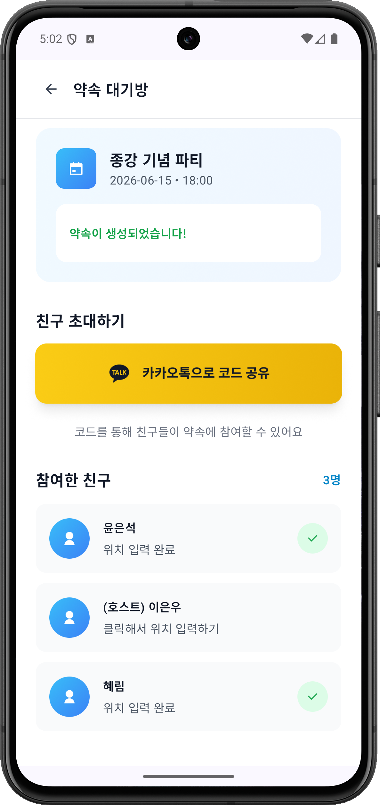
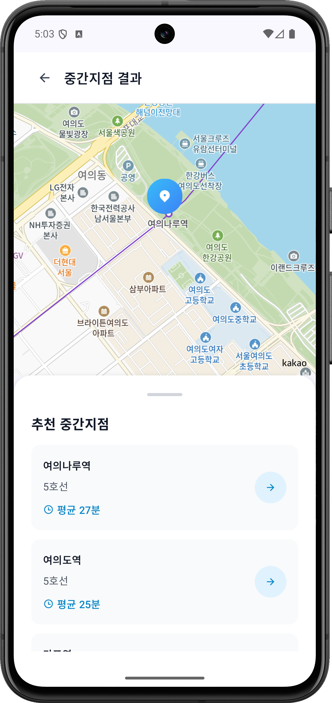
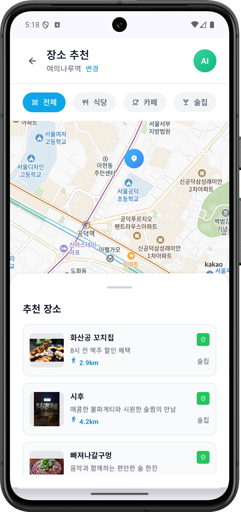
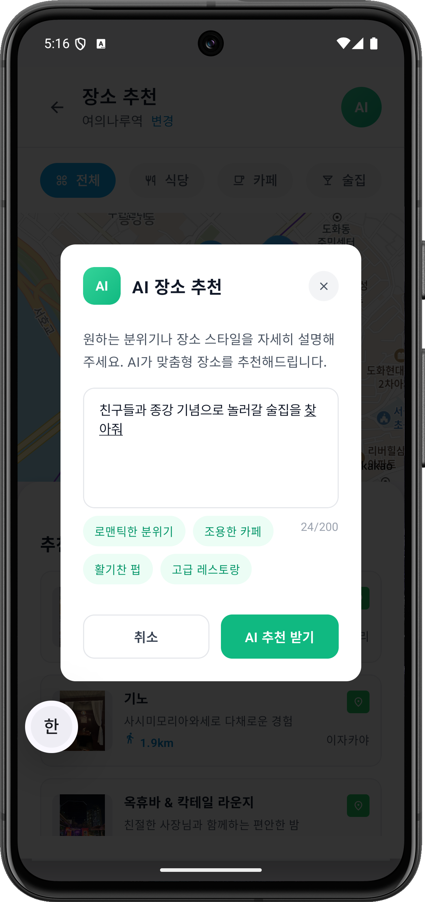
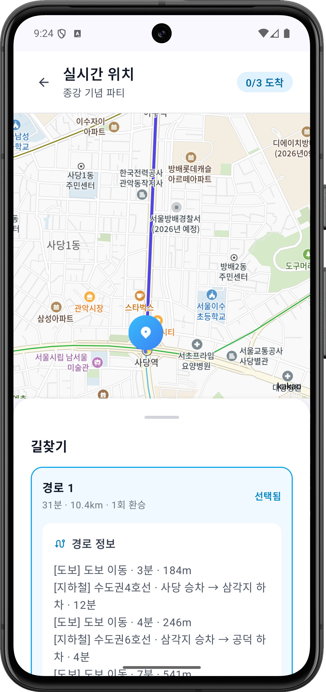
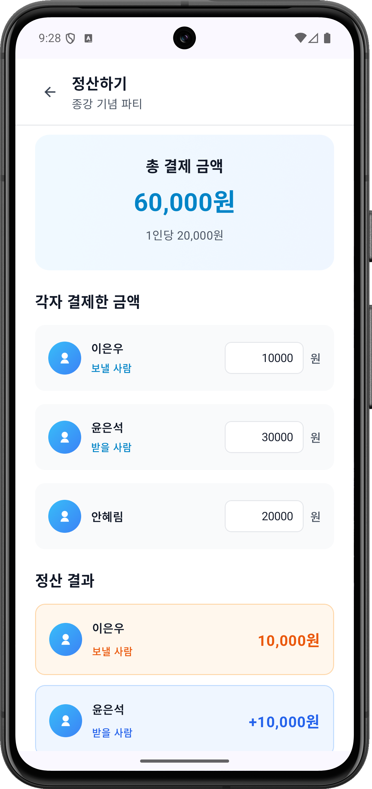
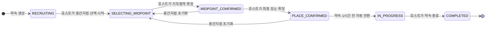
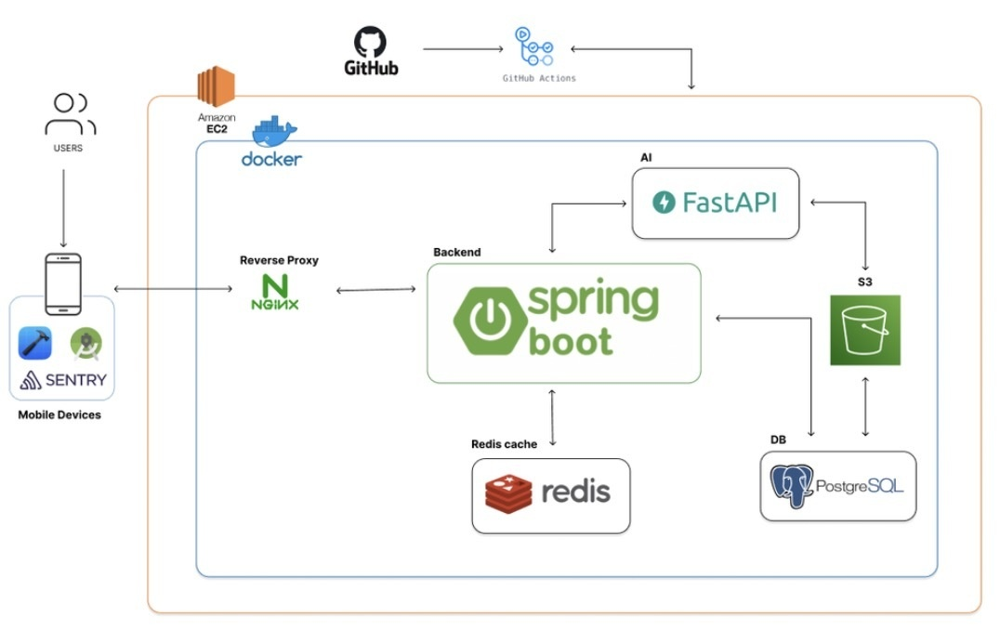

# GgUd — 약속 조율 서비스 백엔드

> 친구들의 출발지를 모아 **모두에게 공평한 중간 지하철역**을 찾고, **AI가 근처 장소를 추천**하고,
> 약속 당일 **실시간 위치 공유**와 **자동 정산**까지 한 번에 끝내는 약속 조율 앱의 백엔드입니다.


<br>

## 목차

- [서비스 소개](#서비스-소개)
- [앱 스크린샷](#앱-스크린샷)
- [주요 기능](#주요-기능)
- [약속 진행 흐름](#약속-진행-흐름)
- [시스템 아키텍처](#시스템-아키텍처)
- [기술 스택](#기술-스택)
- [기술적 고민과 해결](#기술적-고민과-해결)
- [API 개요](#api-개요)
- [시작하기](#시작하기)
- [프로젝트 구조](#프로젝트-구조)
- [CI/CD](#cicd)
- [라이선스](#라이선스)

<br>

## 서비스 소개

여럿이 만날 때 반복되는 고민이 있습니다.

- **"어디서 만나지?"** — 누군가는 항상 멀리서 와야 합니다.
- **"거기서 뭐 하지?"** — 장소를 정하려고 지도 앱과 단톡방을 오갑니다.
- **"다들 어디쯤이야?"** — 약속 당일 "어디야?" 메시지가 쏟아집니다.
- **"얼마 보내면 돼?"** — 누가 누구에게 얼마를 보낼지 계산이 번거롭습니다.

**GgUd**는 이 과정을 하나의 흐름으로 묶습니다. 호스트가 약속을 만들고 카카오톡으로 초대하면,
참여자들의 출발지를 기반으로 중간 지하철역 후보와 각자의 대중교통 소요 시간을 보여 주고,
확정된 역 주변 장소를 AI가 추천합니다. 약속 당일에는 서로의 위치와 도착 여부를 실시간으로 확인하고,
끝난 뒤에는 최소 이체 횟수로 정산 결과를 카카오톡으로 받아 볼 수 있습니다.

<br>

## 앱 스크린샷

<!-- 스크린샷을 추가하려면 docs/images/screenshots/ 에 이미지를 넣고 아래 표에 열을 추가하세요. -->

| 약속 대기방 · 초대 | 중간지점 추천 | 장소 추천 |
| :---: | :---: | :---: |
|  |  |  |
| 카카오톡으로 초대 코드를 공유하고<br>참여자별 출발지 입력 현황을 확인 | 출발지 기준 중간 지하철역 후보와<br>평균 소요 시간을 지도와 함께 제공 | 확정된 역 주변 장소를<br>식당 · 카페 · 술집 탭으로 나눠 추천 |

| AI 맞춤 추천 | 실시간 위치 · 길찾기 | 정산 |
| :---: | :---: | :---: |
|  |  |  |
| 원하는 분위기를 자연어로 적으면<br>AI가 맞춤 장소를 추천 | 참여자 위치와 도착 인원을 실시간 공유하고<br>약속 장소까지 대중교통 경로 안내 | 각자 결제한 금액을 입력하면<br>누가 누구에게 얼마를 보낼지 계산 |

<br>

## 주요 기능

### 1. 카카오 로그인 · 초대
- 카카오 SDK 로그인 후 서비스 자체 **JWT(Access/Refresh)** 발급
- 약속 생성 시 **초대 코드** 발급 → 카카오톡으로 공유, 코드는 **24시간 유효**
- 약속당 **최대 10명** 참여 (동시 참여 요청은 비관적 락으로 정원 초과 방지)

### 2. 중간지점(지하철역) 추천
- 참여자들의 출발지 좌표로 중간 지점을 계산하고, 가장 가까운 **지하철역 5곳**을 후보로 제시
- 후보 역마다 **참여자별 대중교통 소요 시간**(TMap)과 평균 거리를 함께 제공해 공평한 역을 고를 수 있음
- 서울 · 인천 지하철역 데이터(CSV)를 앱 기동 시 자동 적재
- 역 확정은 **호스트만** 가능하며, 확정 후에도 초기화하고 다시 고를 수 있음

### 3. AI 장소 추천
- 별도 **AI 추천 서버**와 연동해, 중간지점이 확정되면 해당 역 주변 장소를 우선 추천
- **전체 / 음식점 / 카페 / 술집** 탭 필터와 "조용한 카페"처럼 **자연어 요청** 지원
- 추천 결과 중 하나를 호스트가 **최종 약속 장소로 확정**

### 4. 실시간 위치 공유 · 도착 감지
- **WebSocket(STOMP)** 으로 약속별 위치 채널을 구독해 참여자 위치를 실시간 공유
- 약속 장소 **반경 100m** 안에 들어오면 자동으로 "도착" 처리 후 전체 참여자에게 도착 현황 전파
- 위치 공유는 장소가 확정된 약속에 한해 **약속 1시간 전부터** 허용, 위치 데이터는 Redis에 **2시간 TTL**로 저장 후 자동 삭제

### 5. 정산
- 참여자가 각자 결제한 금액을 입력하면 1인당 부담액을 계산
- **그리디 최소 이체 알고리즘**으로 "누가 누구에게 얼마" 이체 목록 생성
- 호스트가 정산을 완료하면 모든 참여자에게 **카카오톡 메시지**로 결과 발송

### 6. 지도 · 길찾기 · 프로필
- 약속 지도 데이터(참여자 출발지, 중간지점, 최종 장소) 조회
- 출발지 → 약속 장소 대중교통 경로(도보 · 버스 · 지하철 구간별 안내) 조회
- 프로필 이미지 **AWS S3** 업로드

<br>

## 약속 진행 흐름



| 상태 | 설명 |
| --- | --- |
| `CREATED` → `RECRUITING` | 약속 생성 직후 모집 상태로 전환, 참여자가 초대 코드로 참여하며 출발지 입력 |
| `SELECTING_MIDPOINT` | 호스트가 출발지를 확인하고 중간지점 후보 조회 |
| `MIDPOINT_CONFIRMED` | 지하철역 확정, AI 장소 추천 진행 |
| `PLACE_CONFIRMED` | 최종 약속 장소 확정 |
| `IN_PROGRESS` | 스케줄러가 약속 1시간 전 자동 전환, 실시간 위치 공유 활성화 |
| `COMPLETED` | 호스트가 종료, 정산 진행 |
| `CANCELLED` | 호스트가 취소 (완료 · 취소된 약속 제외 어느 단계에서든 가능) |

<br>

## 시스템 아키텍처

<p align="center">
  
</p>

| 구성 요소 | 역할 |
| --- | --- |
| Nginx | 리버스 프록시, 앱의 HTTP · WebSocket 요청을 Spring Boot로 전달 |
| Spring Boot | REST API · WebSocket(STOMP) 서버, 약속 · 중간지점 · 정산 비즈니스 로직 |
| FastAPI | AI 장소 추천 서버 |
| PostgreSQL | 사용자 · 약속 · 참여자 · 정산 · 지하철역 데이터 |
| Redis | 경로 · 지하철역 캐시, 실시간 위치, JWT 블랙리스트 |
| AWS S3 | 프로필 이미지 저장 |
| GitHub Actions | `main` push 시 Docker 이미지 빌드 후 EC2 자동 배포 |
| 외부 API | Kakao(로그인 · 메시지), TMap(대중교통 경로) |

> 서버 구성 요소는 모두 AWS EC2 위에서 Docker 컨테이너로 실행됩니다.
> 이 저장소에는 Spring Boot 서버와 Nginx · PostgreSQL · Redis 구성이 들어 있고, AI 서버(FastAPI)는 별도로 구성됩니다.

<br>

## 기술 스택

| 분류 | 기술 |
| --- | --- |
| Language · Framework | Java 17, Spring Boot 3.5.7, Spring Data JPA, Spring Security, Spring WebFlux(WebClient) |
| Database · Cache | PostgreSQL 15, Redis 7 |
| 인증 | Kakao OAuth, JWT (jjwt 0.12) + Redis 토큰 블랙리스트 |
| 실시간 통신 | WebSocket, STOMP |
| 외부 연동 | Kakao 로그인 · 메시지 API, TMap 대중교통 API, AI 추천 서버(FastAPI), AWS S3 |
| API 문서 | springdoc-openapi (Swagger UI) |
| 인프라 | Docker, Docker Compose, Nginx, AWS EC2 |
| CI/CD | GitHub Actions, Docker Hub |
| 테스트 | JUnit 5, Spring Security Test, WireMock, H2, k6(부하 테스트) |

<br>

## 기술적 고민과 해결

| 문제 | 해결 |
| --- | --- |
| 중간지점 추천마다 외부 경로 API(역 5곳 × 참여자 N명)를 반복 호출 | 출발지-도착지 조합을 키로 **경로 결과를 Redis에 1시간 캐싱**, AI 추천 결과도 저장해 재요청 시 재사용 |
| 다중 경로 조회를 순차 호출하면 전체 응답이 호출 수에 비례해 지연 | **WebClient 논블로킹 호출 + CompletableFuture 병렬 대기**로 동시에 요청하고, 실패한 호출만 기본값으로 대체해 장애 격리 |
| 거의 바뀌지 않는 지하철역 전체 목록을 매 요청마다 DB에서 조회 | `@Cacheable`로 **역 목록 Redis 캐싱(7일 TTL)** |
| 폴링 없이 실시간 위치 공유 · 도착 확인 필요 | **WebSocket(STOMP) + Redis Hash(2시간 TTL)**, Haversine 거리 기반 **100m 도착 자동 감지** |
| 로그아웃 후에도 Access Token이 만료 전까지 유효 | **JWT 이중 토큰 + Redis 블랙리스트**(남은 유효기간만큼 TTL)로 즉시 무효화 |
| 수동 배포의 반복 비용과 휴먼 에러 | **멀티 스테이지 Docker 빌드 + GitHub Actions**로 `main` push 시 EC2 자동 배포 |

**부하 테스트 결과 (k6)** — 중간지점 추천 API, 캐시 warm 상태, 동시 사용자 50명 · 2분

| 평균 응답 | p95 | 에러율 | 처리량 |
| :---: | :---: | :---: | :---: |
| 49.8ms | 81.5ms | 0% | 약 24.8 req/s |

> 로컬 → EC2(Nginx 경유) 원격 측정으로 네트워크 지연이 포함된 수치입니다.

<br>

## API 개요

전체 명세는 서버 실행 후 **Swagger UI**(`/swagger-ui.html`)에서 확인할 수 있습니다.
인증이 필요한 API는 `Authorization: Bearer {accessToken}` 헤더를 사용합니다.

<details>
<summary><b>REST API 목록 펼치기</b></summary>

| 분류 | Method | Endpoint | 설명 |
| --- | --- | --- | --- |
| 인증 | `POST` | `/api/v1/auth/kakao/login` | 카카오 SDK 로그인 (JWT 발급) |
| | `POST` | `/api/v1/auth/refresh` | 토큰 갱신 |
| | `POST` | `/api/v1/auth/logout` | 로그아웃 (토큰 블랙리스트 등록) |
| 사용자 | `GET` | `/api/v1/users/me` | 내 정보 조회 |
| | `PATCH` | `/api/v1/users/me` | 내 프로필 수정 |
| | `POST` | `/api/v1/users/me/profile-image` | 프로필 이미지 업로드 (S3) |
| 약속 | `POST` | `/api/v1/promises` | 약속 생성 |
| | `GET` | `/api/v1/promises` | 내 약속 목록 조회 |
| | `GET` | `/api/v1/promises/{promiseId}` | 약속 상세 조회 |
| | `GET` | `/api/v1/promises/{promiseId}/summary` | 약속 요약 조회 |
| | `GET` | `/api/v1/promises/{promiseId}/status` | 약속 상태 조회 |
| | `PATCH` | `/api/v1/promises/{promiseId}/cancel` | 약속 취소 (호스트) |
| | `PATCH` | `/api/v1/promises/{promiseId}/complete` | 약속 종료 (호스트) |
| 초대 · 참여 | `GET` | `/api/v1/promises/{promiseId}/invite/code` | 초대 코드 조회 |
| | `GET` | `/api/v1/promises/invite/{inviteCode}` | 초대 정보 조회 |
| | `POST` | `/api/v1/promises/join/{inviteCode}` | 약속 참여 |
| | `PUT` | `/api/v1/promises/{promiseId}/departure` | 출발지 입력 |
| | `GET` | `/api/v1/promises/{promiseId}/participants` | 참여자 목록 조회 |
| 중간지점 | `POST` | `/api/v1/promises/{promiseId}/start-midpoint-selection` | 중간지점 선택 시작 (호스트) |
| | `GET` | `/api/v1/promises/{promiseId}/midpoint/recommendations` | 중간지점(지하철역) 추천 |
| | `POST` | `/api/v1/promises/{promiseId}/midpoint/confirm` | 중간지점 확정 (호스트) |
| | `POST` | `/api/v1/promises/{promiseId}/midpoint/reset` | 중간지점 초기화 (호스트) |
| 장소 | `POST` | `/api/v1/promises/{promiseId}/place-recommendations` | AI 장소 추천 (탭 · 자연어) |
| | `POST` | `/api/v1/promises/{promiseId}/midpoint/place-confirm` | 최종 장소 확정 (호스트) |
| 지도 | `GET` | `/api/v1/promises/{promiseId}/map-data` | 지도 데이터 조회 |
| | `GET` | `/api/v1/promises/{promiseId}/directions` | 대중교통 길찾기 |
| 위치 | `GET` | `/api/v1/promises/{promiseId}/arrivals` | 도착 현황 조회 |
| 정산 | `GET` | `/api/v1/promises/{promiseId}/expenses` | 정산 현황 조회 |
| | `PUT` | `/api/v1/promises/{promiseId}/expenses/my` | 내 결제 금액 입력 · 수정 |
| | `POST` | `/api/v1/promises/{promiseId}/expenses/settle` | 정산 완료 + 카카오톡 발송 (호스트) |
| 기타 | `GET` | `/api/health` | 헬스 체크 |

</details>

<details>
<summary><b>WebSocket (STOMP) 펼치기</b></summary>

| 구분 | 경로 | 설명 |
| --- | --- | --- |
| 연결 | `/ws` | CONNECT 시 `Authorization: Bearer {accessToken}` 헤더 필요 |
| 발행 | `/app/promises/{promiseId}/location` | 내 위치 전송 (`latitude`, `longitude`) |
| 구독 | `/topic/promises/{promiseId}/locations` | 참여자 위치 업데이트 수신 |
| 구독 | `/topic/promises/{promiseId}/arrivals` | 도착 이벤트 · 도착 인원 수신 |

</details>

<br>

## 시작하기

### 요구 사항

- JDK 17
- Docker (PostgreSQL · Redis 실행용)
- 외부 API 키: Kakao, TMap, (선택) AWS S3, AI 추천 서버 주소

### 1. 저장소 복제

```bash
git clone https://github.com/2025-INU/Backend.git
cd Backend
```

### 2. PostgreSQL · Redis 실행

> 루트의 `docker-compose.yml`은 **운영(EC2) 배포용**입니다(Docker Hub 이미지 사용, `/opt/ggud` 볼륨, 외부 네트워크).
> 로컬에서는 DB와 Redis만 따로 띄우면 됩니다.

```bash
docker run -d --name ggud-postgres -p 5432:5432 \
  -e POSTGRES_USER=postgres -e POSTGRES_PASSWORD=postgres -e POSTGRES_DB=ggud_db \
  postgres:15-alpine

docker run -d --name ggud-redis -p 6379:6379 redis:7-alpine
```

### 3. 환경 변수 설정

프로젝트 루트에 `.env` 파일을 만들고 값을 채웁니다. (`.env`는 커밋하지 마세요.)

```bash
# Database
DB_USERNAME=postgres
DB_PASSWORD=postgres
REDIS_PASSWORD=

# JWT (필수, 32자 이상 — 예: openssl rand -base64 32)
JWT_SECRET=your-jwt-secret

# Kakao
KAKAO_REST_API_KEY=
KAKAO_CLIENT_SECRET=
KAKAO_JAVASCRIPT_KEY=
KAKAO_REDIRECT_URI=

# 외부 서비스
TMAP_APP_KEY=
AI_SERVER_URL=http://localhost:8000

# AWS S3 (프로필 이미지 업로드 시)
AWS_ACCESS_KEY_ID=
AWS_SECRET_ACCESS_KEY=
AWS_REGION=ap-northeast-2
AWS_S3_BUCKET=
```

| 변수 | 필수 | 설명 |
| --- | :---: | --- |
| `JWT_SECRET` | ✅ | JWT 서명 키 (기본값 없음) |
| `DB_USERNAME`, `DB_PASSWORD` | ✅ | 로컬 PostgreSQL 계정 |
| `KAKAO_*` | 로그인 · 메시지 사용 시 | 카카오 디벨로퍼스 앱 키 |
| `TMAP_APP_KEY` | 중간지점 소요 시간 · 길찾기 사용 시 | TMap 대중교통 API 키 |
| `AI_SERVER_URL` | 장소 추천 사용 시 | AI 추천 서버 주소 |
| `AWS_*` | 프로필 이미지 사용 시 | S3 접근 정보 |

### 4. 애플리케이션 실행

기본 프로필은 `local`이며, 로컬 프로필은 실행 시 스키마를 새로 생성합니다(`ddl-auto: create`).

```bash
set -a && source .env && set +a
./gradlew bootRun
```

| 확인 | 주소 |
| --- | --- |
| 헬스 체크 | http://localhost:8080/actuator/health |
| Swagger UI | http://localhost:8080/swagger-ui.html |

### 5. 테스트

```bash
./gradlew test
```

<br>

## 프로젝트 구조

```
src/main/java/dev/promise4/GgUd
├── client/        # 외부 API 클라이언트 (AI 추천 서버, Kakao)
├── common/        # 공통 엔티티(BaseTimeEntity), 예외, 에러 코드
├── config/        # Security, Redis, WebSocket, WebClient, S3, Swagger 설정
├── controller/    # REST · STOMP 컨트롤러와 요청/응답 DTO
├── entity/        # JPA 엔티티 (User, Promise, Participant, SubwayStation …)
├── exception/     # 도메인 예외 · 전역 예외 처리
├── repository/    # Spring Data JPA 리포지토리
├── scheduler/     # 약속 자동 시작 등 스케줄러
├── security/      # JWT 필터 · 토큰 발급, 카카오 OAuth
└── service/       # 비즈니스 로직 (약속, 중간지점, 장소 추천, 위치, 정산 …)

src/main/resources
├── application*.yml   # 공통 / local / prod 설정
├── data/              # 서울 · 인천 지하철역 CSV
└── db/migration/      # SQL 마이그레이션 스크립트
```

<br>

## CI/CD

| 워크플로 | 트리거 | 동작 |
| --- | --- | --- |
| [ci.yml](.github/workflows/ci.yml) | `main` 대상 Pull Request | PostgreSQL · Redis 서비스 컨테이너를 띄워 빌드 및 테스트 |
| [cd-prod.yml](.github/workflows/cd-prod.yml) | `main` push, 수동 실행 | Docker 이미지 빌드 → Docker Hub 푸시 → EC2에서 `docker compose pull && up` |

<br>

## 라이선스

[MIT License](LICENSE) © 2025 INU 캡스톤디자인
